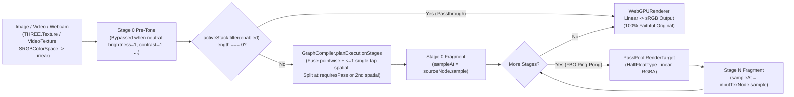

# Quick Task 261126-hlm: Fix All 16 Shaders Visual Fidelity, Media-First Non-ASCII Default & Composable Shader Stack — Research

**Researched:** 2026-11-26
**Domain:** Three.js `0.187.0` WebGPU/TSL + WebGL2 fallback post-processing pipeline, Zustand studio state, React 19 UI/UX
**Confidence:** HIGH (every root cause and TSL API verified directly against the workspace source and installed `three@0.187.0` runtime)

---

## Summary

The `web/` Studio currently suffers from **five systemic engine bugs** plus **shader-specific algorithmic defects across all 16 stylize/modulate shaders** and **stale legacy wiring** between the Zustand store, `CenterStage`, `Pipeline`, and `GraphCompiler`. Together, these explain every symptom reported by the user:

1. **Why ASCII looks like a fixed/noisy layer over the photo:** `GraphCompiler.ts` passes a per-pixel `vec4` color node (`current`) instead of a UV-sampling function and **never provides `env.sampleAt`**. In `web/src/engine/registry/stylize/ascii.ts`, `env?.sampleAt` is `undefined`, so `sampledColor = inputNode` samples the *un-quantized original pixel* inside each character cell. Every pixel inside one glyph picks a different `charIdx` and a different RGB color, leaking the full-resolution photo behind fragmented glyphs. On top of that, `TextureAtlas.ts` uses `NearestFilter` on a `32px` font canvas with no padding gutter, and `Pipeline.updateAscii()` updates `'legacy-ascii'` instead of active stack pass instances (`'initial-ascii'`, `'ascii-...'`), breaking `dense` (70 chars) and `blocks` (5 chars) ramps.
2. **Why contrast/thresholds/luminance look crushed or dark across shaders:** `CenterStage.tsx` sets `tex.colorSpace = THREE.SRGBColorSpace` on uploaded images/videos, and Three.js `0.187.0` `WebGPURenderer` (`outputColorSpace = SRGBColorSpace` by default) **already** converts textures from sRGB to Linear on read and converts Linear to sRGB in `renderOutput()` on final screen output. `GraphCompiler.ts` calls `sRGBToLinear(sourceNode)` on input AND `linearTosRGB(current)` on final output — **double-linearizing inputs** (`pow(x, 2.4)` twice, crushing `0.5` sRGB mid-gray down to `0.038`) and **double-gamma-encoding outputs**. Furthermore, Rec. 601 luma (`0.299R + 0.587G + 0.114B`) must be evaluated in **perceptual sRGB** space for glyph/dot/threshold/dither mapping, not linear light.
3. **Why clicking shaders in the Left Rail breaks sliders and why `vhs` does nothing:**
   - `SourceAndShaderPanel.tsx` uses `mode: 'vhs'`, which does **not exist** in `EffectRegistry` (which registers `'crtVhs'`). Clicking `vhs` produces a dead no-op pass.
   - `CenterStage.tsx` runs `useEffect(() => pipeline.setEffect(effect), [effect])` *after* `useEffect(() => pipeline.syncStack(activeStack, activeTier), [activeStack, activeTier])`. Clicking any shader calls `setSingleEffectFastPath`, which updates both `activeStack` and `effect`; React then executes `pipeline.setEffect(effect)` -> `syncLegacyStack()`, **overwriting** the compiled `activeStack` with `[legacy-tone, legacy-<effect>]` (`parameters: {}`), breaking all `EffectInspector` slider updates (which target `pass.instanceId`).
   - Right Rail `ToneControls` calls `pipeline.updateTone(tone)` targeting `'legacy-tone'`, which does not exist in `activeStack`, rendering the entire Tone Curve panel inert.
   - All `'select'` dropdown parameters (`pixelSort.direction`, `dither.matrixType`, `masks.shape`, `crtVhs.profile`, `threeD.renderMode`) are JS strings not bound as uniforms and not hashed in `computeTopologyHash`, so changing any `<select>` in `EffectInspector` has zero effect until topology changes.
4. **Why spatial/neighborhood shaders are broken or flat:** `blockify`, `edgeDetect`, `pixelSort`, `rgbSplit`, and `crtVhs` all depend on `env?.sampleAt` (missing in `GraphCompiler`). Meanwhile, `voronoi` doesn't implement Voronoi at all (it renders a square radial gradient), `matrix` renders vertical gradient bars with zero glyphs, `waveLines` renders vertical sine stripes ignoring image luminance, `halftone` and `dots` lack aspect-ratio correction and `fwidth()` anti-aliasing, `contour` lacks `fwidth()` derivative line normalization, and `noise` uses un-floored `st * 10` sin-hash causing diagonal moiré stripes.
5. **Why ASCII is forced on upload:** `DEFAULT_INITIAL_STACK` in `useStudioStore.ts` initializes with `initial-ascii`, `effect: 'ascii'`, and `Pipeline.ts` defaults `activeEffect = 'ascii'`. Changing default stack to `[]` (passthrough) and removing legacy `syncLegacyStack()` makes uploaded media render at true native quality/aspect first, while allowing arbitrary sequential composition (`dither` -> `vhs`, `ascii` -> `vhs`, etc.) via `GraphCompiler` + `PassPool` ping-pong `HalfFloatType` RenderTargets.

**Primary recommendation:** Remove the dead `web/src/engine/shaders/*.ts` and `Pipeline.syncLegacyStack()` paths, fix `GraphCompiler.ts` color-space handling and `sampleAt` / multi-stage ping-pong FBO execution (`HalfFloatType`), upgrade all 16 shader definitions in `web/src/engine/registry/` with perceptual Rec. 601 luma + aspect-corrected `fwidth()` AA + authentic algorithms, unify `'vhs'`/`'crtVhs'`, and default `useStudioStore` to an empty passthrough stack (`[]`) with unified stack/select/replace controls.

---

## Project Constraints (from GEMINI.md)

- **Web Studio build gate:** Run `npm run build` (`tsc --noEmit && vite build`) in `web/` to type-check and bundle the frontend `[VERIFIED: GEMINI.md:18]`, `[VERIFIED: web/package.json:8]`.
- **Zero-chroma UI design system (`DESIGN.md`):** Studio UI uses Obsidian Ink (`#0c0d10`), Elevated Charcoal (`#13151a`), Active Slate (`#1d2028`), Hairline Steel (`#262932`), Crisp Chalk (`#e9ebf0`), `Archivo` typography, sharp `0px` docked controls, and frosted liquid glass strictly on floating overlays (`ViewportHUD`, `MobileSheet`, popovers) — never add colored status dots, accent hues, or decorative scanline CSS `[VERIFIED: DESIGN.md:88-146]`.
- **Browser-only product surface:** Client-side WebGPU/TSL with WebGL2 fallback; all existing unit tests in `web/src/tests/` must pass (`npm run test:unit`) `[VERIFIED: web/package.json:10]`.

---

## Architectural Responsibility Map

| Capability | Primary Tier | Secondary Tier | Rationale |
|------------|-------------|----------------|-----------|
| Media ingestion, native dimensions & aspect framing | Browser / Client (`useStudioStore`, `CenterStage`) | — | Local `File`/webcam/sample decoded in-browser with zero upload |
| Stack state, ordering, bypass, parameter values | Browser / Client (`useStudioStore`) | `LeftRail`, `RightRail`, `MobileSheet` | Single source of truth (`activeStack`, `tone`, `ascii`) |
| Stage planning, pointwise fusion & FBO ping-pong | GPU Pipeline (`GraphCompiler`, `PassPool`, `Pipeline`) | `capabilities.ts` | Compiles minimal stages, splits multi-tap/spatial passes cleanly |
| Pixel/glyph/analog shader execution (16 modes + modulate) | GPU Fragment Shaders (`three/tsl` on WebGPU/WebGL2) | `TextureAtlas` | 60fps real-time evaluation in Linear working light / perceptual luma |
| Raster/Vector/Clip export | Browser / Client (`export/*`) | FastAPI FFmpeg (`src/api/`) | Client PNG/JPEG/SVG/TXT/WebM/GIF + optional server HD MP4/GIF |

---

## Standard Stack

| Library / Runtime | Version (Verified) | Purpose | Notes |
|-------------------|--------------------|---------|-------|
| `three` (`three/webgpu` & `three/tsl`) | `0.187.0` `[VERIFIED: web/package.json:18]` | WebGPU + automatic WebGL2 fallback node shader engine | Exports `fwidth`, `smoothstep`, `dFdx`, `dFdy`, `Loop`, `If`, `sample`, `HalfFloatType` `[VERIFIED: web/node_modules/three/build/three.tsl.js]` |
| `react` / `react-dom` | `19.3.1` `[VERIFIED: web/package.json:16-17]` | Studio shell & inspector UI | — |
| `zustand` | `5.1.0` `[VERIFIED: web/package.json:19]` | Studio & stack state store | Uses ES2024 `toSpliced` in `reorderStack` |
| `vitest` + `jsdom` | `5.1.1` `[VERIFIED: web/package.json:34]` | Unit & pipeline graph tests | `cd web && npm run test:unit` (10 files, 122 tests passing) |
| `@playwright/test` | `1.65.1` `[VERIFIED: web/package.json:22]` | E2E shader & studio verification | `cd web && npm run test:e2e` (Chromium SwiftShader WebGL2/WebGPU) |

---

## Part 1: Systemic Pipeline & Engine Root Causes

### 1.1 Missing `env.sampleAt` Breaks Spatial & Neighborhood Shaders
- **Evidence:** `web/src/engine/registry/types.ts:28` defines `sampleAt?: (uvCoord: any) => any;` `[VERIFIED: web/src/engine/registry/types.ts:28]`. Yet `web/src/engine/Pipeline.ts:157-162` builds `env` as `{ resolution, time, seed, textureAtlas }` and `web/src/engine/graph/GraphCompiler.ts:160-203` passes `current` (a `vec4` color node at default `uv()`) to `def.buildNode(current, passUniforms, env)` without setting `env.sampleAt` `[VERIFIED: web/src/engine/graph/GraphCompiler.ts:160-203]`.
- **Impact:** Every effect calling `env?.sampleAt(coord)` (`ascii`, `blockify`, `edgeDetect`, `pixelSort`, `rgbSplit`, `crtVhs`) falls back to reading `inputNode` at the current un-shifted pixel `uv()`.
- **Fix using Three.js `0.187.0` `TextureNode.sample(uvNode)`:**
  - Verified in `web/node_modules/three/build/three.tsl.js:19338-19346`: `TextureNode.prototype.sample(uvNode)` clones the `TextureNode`, assigns `uvNode`, and sets `textureNode.referenceNode = this.getBase()`. Because `get value()` delegates to `this.referenceNode.value` (`three.tsl.js:18773-18777`), mutating `inputTextureNode.value = target.texture` in `Pipeline.render()` dynamically updates every `.sample(customUV)` call in that stage!
  - Note: For `dummyTexture` in `GraphCompiler.ts:118`, set `dummyTexture.minFilter = THREE.LinearFilter; dummyTexture.magFilter = THREE.LinearFilter; dummyTexture.generateMipmaps = false;` and `dummyTexture.isRenderTargetTexture = true` (or acquire a clean default texture) so Three.js `setupUV()` handles WebGL2 vs WebGPU `flipY` consistently (`three.tsl.js:18956`).

### 1.2 Double Color-Space Conversion Crushes Luminance & Washes Highlights
- **Evidence:**
  1. `CenterStage.tsx:366,374` sets `tex.colorSpace = THREE.SRGBColorSpace;` `[VERIFIED: web/src/components/layout/CenterStage.tsx:366,374]`.
  2. `WebGPURenderer` sets `this.outputColorSpace = SRGBColorSpace` (`three.webgpu.js:22491`) and wraps final screen rendering (`isOutputTarget === true`) in `renderOutput(outputNode, toneMapping, outputColorSpace)` (`three.webgpu.js:20806, 52723`), while intermediate `RenderTarget` rendering (`isOutputTarget === false`) outputs in `ColorManagement.workingColorSpace` (Linear) (`three.webgpu.js:25232`).
  3. On texture read, hardware `SRGB8_ALPHA8` / `rgba8unorm-srgb` (for `Texture`) and `needsToWorkingColorSpace` (for `VideoTexture`, `three.webgpu.js:27987-27990`) **already convert sRGB textures to Linear working light**.
  4. `GraphCompiler.ts:128-129, 161, 210-212` runs `sRGBToLinear(sourceNode)` on input AND `linearTosRGB(current)` on final output `[VERIFIED: web/src/engine/graph/GraphCompiler.ts:128-212]`.
- **Impact:**
  - `sRGBToLinear(sourceNode)` **double-linearizes** already-linear inputs (`0.5` sRGB -> `0.214` linear -> `0.038` doubly-linear!). All luminance-driven shaders (`ascii`, `dither`, `threshold`, `halftone`, `contour`, `crosshatch`, `dots`) see dark-crushed values.
  - `linearTosRGB(current)` on the final stage **double-encodes** output (`renderOutput` encodes it a second time!).
  - Intermediate `RenderTarget`s use `THREE.UnsignedByteType` (`RGBA8`), quantizing Linear `[0..1]` to 8-bit and causing dark banding.
- **Fix:**
  - **Remove `sRGBToLinear` on Stage 0 input and `linearTosRGB` on Final Stage output** in `GraphCompiler.ts`! All stages operate cleanly in **Three.js Linear working color space**, and `WebGPURenderer` handles sRGB <-> Linear at both boundaries automatically.
  - **Use `THREE.HalfFloatType`** in `GraphCompiler.ts` `targetDescriptor` (with `UnsignedByteType` fallback if needed) so intermediate FBOs preserve 16-bit linear precision with zero dark banding.
  - **Perceptual Luma Helper (`rec601PerceptualLuminance`):** Inside `web/src/engine/color/luminance.ts`, add a helper that converts Linear RGB -> perceptual sRGB via `linearTosRGB(rgb)` before computing `0.299*R + 0.587*G + 0.114*B`! That guarantees `sRGB 0.5` mid-gray evaluates to `0.500` luminance for ASCII character selection, Bayer steps, halftone dot area, threshold cutoff, and contour bands, while optical blending (`applyBlendMode`, bloom, aberration) remains physically linear.

### 1.3 `Pipeline.syncLegacyStack()` & `CenterStage` Clobber `activeStack` & Break Sliders
- **Evidence:**
  - `CenterStage.tsx:287-317` runs BOTH `pipeline.syncStack(activeStack, activeTier)` AND `pipeline.setEffect(effect)` `[VERIFIED: web/src/components/layout/CenterStage.tsx:287-317]`.
  - Calling `setSingleEffectFastPath('dither')` updates `activeStack` AND `effect: 'dither'`. React runs `syncStack([dither])`, then runs `pipeline.setEffect('dither')`, which calls `syncLegacyStack()` (`Pipeline.ts:281-328`) — **overwriting the pipeline with `['legacy-tone', 'legacy-dither']` and empty `{}` parameters** `[VERIFIED: web/src/engine/Pipeline.ts:281-328]`.
  - Subsequent `EffectInspector` slider edits call `updateUniform(pass.instanceId, ...)` (`dither-xxxx`), which no longer exists in `uniformsMap`, making sliders completely unresponsive!
  - Likewise, `ToneControls` calls `pipeline.updateTone(tone)` -> `updateUniform('legacy-tone', ...)` which doesn't exist in `activeStack`, making the Right Rail "Tone curve" panel a no-op.
  - `Pipeline.updateAscii(ascii)` (`Pipeline.ts:246-254`) updates `'legacy-ascii'`'s `rampLength`, never updating active `'ascii'` passes in `activeStack`.
- **Fix:**
  - Delete `syncLegacyStack()`, `legacyParams`, `setEffect()`, `updateEffectParam(key, val)` from `Pipeline.ts` and remove the `[effect]` / `[effectParams]` `useEffect`s from `CenterStage.tsx`.
  - Delete the unused legacy `web/src/engine/shaders/*.ts` files (zero imports across `web/src/`).
  - Wire `store.tone` as an implicit **Stage-0 pre-tone node** in `Pipeline` / `GraphCompiler` with dedicated `'__preTone__:*'` uniforms (bypassed automatically when neutral `1,1,1,0,1,false` so raw media stays untouched).
  - Have `Pipeline.updateAscii(ascii)` iterate over `this.currentStack` (and `uniformsMap`) to update `rampLength` on all `'ascii'`, `'matrix'`, and `'threeD'` passes whenever `rampPreset` or `customChars` changes.

### 1.4 `'select'` Parameters Never Update Live Without Topology Rebuild
- **Evidence:** `GraphCompiler.ts:50` hashes `${idx}:${p.effectId}:${p.blendMode}` and lines 182-188 only wrap `number` and `boolean` in `uniform(...)`; string `'select'` values (`pixelSort.direction`, `dither.matrixType`, `masks.shape`, `crtVhs.profile`, `threeD.renderMode`) are stored raw `[VERIFIED: web/src/engine/graph/GraphCompiler.ts:50,182-188]`.
- **Fix:** Encode `'select'` parameters as `uniform(optionIndex)` (`schema.options.indexOf(val)`) in `GraphCompiler.ts` and `Pipeline.updateUniform()`, so changing any dropdown updates the GPU shader instantaneously with zero recompilation! When `crtVhs.profile` changes in `useStudioStore.updatePassParam`, also apply `applyCrtProfile(profileName)` to the pass's sliders so the UI stays synced.

### 1.5 Uncapped `img.onload` Resize & Idle 60fps Burn on Static Images
- **Evidence:** `CenterStage.tsx:340-354` caps canvas dimensions at `TIER_CONFIGS[activeTier].maxDimension`, but `CenterStage.tsx:369` (`img.onload`) calls `pipeline.resize(dimensions.width, dimensions.height)` **uncapped**, and `CenterStage.tsx:149` (`return s.mediaType !== null;`) forces a continuous 60fps loop even on static images `[VERIFIED: web/src/components/layout/CenterStage.tsx:149,369]`. Additionally, `CenterStage.tsx:177` overwrites canvas dimensions with `canvas.clientWidth || 800, canvas.clientHeight || 600` after `init()`.
- **Fix:** Centralize `applyCappedResize(dimensions, activeTier)` in one helper; render on-demand for static images unless an animated effect (`matrix`, `waveLines`, `noise`, `grain`, `vhs`/`crtVhs`, `threeD`, `pixelSort` with time, or live audio) is enabled; and trigger an explicit `pipeline.render()` right before `imageExport.ts` `canvas.toBlob()` so WebGL2 (`preserveDrawingBuffer: false`) never exports a blank buffer.

---

## Part 2: Diagnosis & Modernized Design for All 16 Shaders (+ `threeD` & Modulate)

All 16 shaders listed in `SourceAndShaderPanel.tsx` (`ascii`, `dither`, `halftone`, `vhs`, `matrix`, `dots`, `contour`, `pixelSort`, `blockify`, `threshold`, `edgeDetect`, `crosshatch`, `waveLines`, `noise`, `voronoi`, `tone`) plus `threeD`, `grain`, `rgbSplit`, and `masks` are audited below.

> **Key UX Rule Across All Shaders:** Each stylizing shader must genuinely **transform** the uploaded media into that medium's authentic visual language (crisp black/paper background where appropriate, clean subject luminance mapping, aspect-corrected geometry, `fwidth()` anti-aliasing, zero muddy source bleed-through). Preserving original color vs monochrome should be an explicit, tasteful parameter (`colorMode` / `monochrome` / `colorize`) per shader rather than accidental RGB bleed.

| # | Shader ID | Current Root Defect(s) | Modernized WebGPU/WebGL2 TSL Design & Defaults |
|---|-----------|------------------------|-------------------------------------------------|
| 1 | `ascii` (`stylize/ascii.ts` + `TextureAtlas.ts`) | (1) `env.sampleAt` missing -> reads per-pixel color instead of cell average -> photo bleeds through sliced glyphs. (2) Double-linearized lum crushes shadows to `' '` / `'.'`. (3) `TextureAtlas` uses `32px` regular font + `NearestFilter` + no slot gutter. (4) `rampLength` never updates on active pass when changing preset. | **4-tap box supersample** inside each cell `(cellW = max(4, cellScale * charAspect), cellH = max(4, cellScale))` via `sampleAt`. Compute **perceptual Rec. 601 luma** with slight contrast curve + noise floor (`< 0.03` -> space). Render `TextureAtlas` at **`64px` bold monospace** with `4px` internal slot gutter + `THREE.LinearFilter`, and apply `smoothstep(0.48 - w, 0.48 + w, alpha)` (`w = clamp(fwidth(alpha), 0.06, 0.22)`) for razor-sharp glyphs at any scale. Add `colorMode`: `'truecolor' | 'monochrome' | 'green' | 'amber'`, `bgColor` (`#060709`), `contrast` (`1.15`). Defaults: `cellScale: 10`, `charSpacing: 1`, `charAspect: 0.55`. |
| 2 | `dither` (`stylize/dither.ts`) | (1) Operates on doubly-linearized values -> dark crush. (2) Hardcoded 1×1 px cells invisible at 1080p/Retina. (3) Only `bayer4` supported (`bayer2`/`bayer8`/`ign` missing). (4) No `monochrome` 1-bit/grayscale option. | Add `pixelSize` (`1..8 px`, default `2.0`) snapping sample UV to pixel-art cell center via `sampleAt`. Convert to **perceptual sRGB** for quantization, then back to Linear. Support `matrixType`: `'bayer4' | 'bayer8' | 'bayer2' | 'ign'` (Interleaved Gradient Noise). Scale Bayer matrix `bVal ∈ [-0.5, 0.5]` by `spread / (colorSteps - 1)`. Add `monochrome` boolean (default `false`). Defaults: `matrixType: 'bayer8'`, `colorSteps: 4`, `pixelSize: 2`, `spread: 0.85`. |
| 3 | `halftone` (`stylize/halftone.ts`) | (1) Normalized `uv()` causes oval dots on non-square media. (2) Samples pixel RGB instead of rotated dot center -> slices dots at edges. (3) Binary `lessThanEqual` aliases badly. (4) Linear radius instead of area-proportional `sqrt(lum)`. | Transform to **aspect-corrected pixel coords** `(st - 0.5) * resolution`, rotate by `angle`, quantize to `cellSize = resolution.y / frequency`, rotate cell center back to UV and `sampleAt(cellCenterUV)`. Compute perceptual luma `lum` -> **area-proportional radius** `r = sqrt(lum) * 0.5 * dotRadius`. Smooth edge with `1.0 - smoothstep(r - aa, r + aa, dist)` (`aa = max(fwidth(dist), 0.02)`). Support `mode`: `'color' | 'monochrome' | 'cmyk'` (4-screen CMYK plates at 15°/75°/0°/45°). Defaults: `frequency: 45`, `angle: 45`, `dotRadius: 1.05`, `mode: 'color'`. |
| 4 | `vhs` / `crtVhs` (`modulate/crtVhs.ts` + UI ID fix) | (1) **UI uses `'vhs'` which is unregistered** (`crtVhs` in registry) -> total no-op! (2) `sampleAt` missing -> curvature & tracking jitter never warp image! (3) Sin scanlines moiré against pixel grid; no chroma bleed. (4) `profile` select never updates sliders/uniforms. | Register `'vhs'` cleanly (or alias `'vhs'` -> `'crtVhs'` in `EffectRegistry` while unifying UI & `EffectMode`). With real `sampleAt`: apply barrel curvature `0.5 + cc * (1 + curvature * r2)` with smooth anti-aliased rounded bezel (`smoothstep`), horizontal VHS tracking wave + periodic head-switch tear, **3-tap horizontal chroma subsampling & R/B aberration**, anti-aliased scanlines, subtle RGB aperture grille option, and 5-tap highlight phosphor bloom. Sync `profile` selection in `useStudioStore` via `applyCrtProfile()`. Defaults: `curvature: 0.08`, `scanlineIntensity: 0.35`, `scanlineCount: 320`, `trackingJitter: 0.25`, `aberration: 2.5`, `bloomIntensity: 0.25`, `vignette: 0.2`, `noiseIntensity: 0.12`. |
| 5 | `matrix` (`stylize/matrix.ts`) | Renders vertical sawtooth gradient stripes with **zero glyphs** (`TextureAtlas` never sampled), no discrete character cells, and flat white blobs. | Quantize into aspect-corrected monospace cells (`cellW = resolution.x / density`, `cellH = cellW * 1.45`). Sample `sampleAt(cellCenterUV)` for perceptual `lum`. Per-column speed/phase hash drives falling rain trail + leading white-green head (`vec3(0.78, 1.0, 0.85)`). Each cell selects a flickering glyph from `TextureAtlas` (with `LinearFilter` + `smoothstep` sharpening) and modulates phosphor green (`vec3(0.05, 1.0, 0.35)`) by `lum * 0.8 + stream * 0.45` so subject silhouette emerges crisply through cascading code. Defaults: `density: 60`, `speed: 1.0`, `dropLength: 8.0`. |
| 6 | `dots` (`stylize/dots.ts`) | (1) Reads full-res pixel color inside each circle instead of cell center -> peephole effect. (2) No `fwidth()` AA -> jagged octagons. (3) Linear radius shrinks dark LEDs. | Snap to square pixel grid `cellSize = max(4, spacing)`, sample `sampleAt(cellCenterUV)` for uniform LED color. Compute perceptual `lum` -> `dotR = sqrt(lum) * 0.48 * radius`. Anti-alias with `1.0 - smoothstep(dotR - aa, dotR + aa, dist)` (`aa = max(fwidth(dist), 0.02)`). Composite onto `#050608` (with faint `0.03 * col` LED housing). Defaults: `spacing: 10`, `radius: 1.0`. |
| 7 | `contour` (`stylize/contour.ts`) | (1) `fract(lum * steps) < lineWidth` without `fwidth` draws 40px blobs on smooth gradients and broken dots on edges. (2) Doubly-linearized lum hides shadow contours. | Use 5-tap slightly smoothed perceptual luma `lum` (`sampleAt` cross average so compression noise doesn't speckle). Compute `v = lum * steps` and **derivative-normalized isoline distance**: `f = abs(fract(v - 0.5) - 0.5) / max(fwidth(v), 0.0001); line = 1.0 - smoothstep(lineWidth * 0.5, lineWidth * 0.5 + 1.2, f)`. Every contour line stays uniformly `lineWidth` px crisp! Support `colorize` boolean (`#e9ebf0` chalk vs source-tinted on `#07080b`). Defaults: `steps: 10`, `lineWidth: 1.5`, `colorize: false`. |
| 8 | `pixelSort` (`stylize/pixelSort.ts`) | (1) `sampleAt` missing -> 100% no-op! (2) `rowNoise` uses `time * 0.1` inside `fract(sin(...)*43758)` causing violent white-noise frame strobe. (3) `direction` `'select'` never updates without topology change. | Set `requiresPass: true`. Use **12 directional taps** along `dir` (`horizontal` / `vertical`, bound as int uniform `0/1`) over `sortSpan` with deterministic band-quantized span noise (`floor(scanAxis / bandWidth)` using smooth `sin(time)` instead of random strobe). Sort/smear pixels within `[threshold, highThreshold]` with distance-tapered gradient interpolation so bright highlights streak organically without harsh box dilation. Defaults: `threshold: 0.45`, `sortSpan: 36`, `direction: 'horizontal'`. |
| 9 | `blockify` (`stylize/blockify.ts`) | `sampleAt` missing -> zero pixelation! Only draws aliased grid borders over raw full-res photo. | With real `sampleAt`, snap `cellCenterUV = (floor(pixelCoord / b) + 0.5) * b / resolution` (or 4-tap box average inside block for clean video downsampling). Symmetric tile border SDF `d = max(abs(cellFrac.x - 0.5), abs(cellFrac.y - 0.5))` with `smoothstep` 1px grout darkening (`gridLine`). Defaults: `blockSize: 12`, `gridLine: 0.15`. |
| 10 | `threshold` (`stylize/threshold.ts`) | Doubly-linearized luma pushes `cutoff = 0.5` to `0.87` sRGB (90% pitch black), plus hard binary step causes jagged edges. | Compute perceptual Rec. 601 `lum`. Add `softness` (`0..0.25`, default `0.02`). Evaluate `smoothstep(cutoff - softness - aa, cutoff + softness + aa, lum)` where `aa = max(fwidth(lum) * 0.5, 0.002)`. Output crisp `#07080b` / `#f0f2f6` (with `invert` toggle). Defaults: `cutoff: 0.45`, `softness: 0.02`, `invert: false`. |
| 11 | `edgeDetect` (`stylize/edgeDetect.ts`) | `sampleAt` missing -> ALWAYS executes fallback `lum.mul(sensitivity).fract()` (repeating tonal banding, **not edge detection at all**!). | Set `requiresPass: true`. Implement full **3×3 Sobel operator** (`[-1,0,1; -2,0,2; -1,0,1]`) over perceptual Rec. 601 luma at `thickness / resolution` step. Apply noise-floor `smoothstep(0.06, 0.9, mag * sensitivity)`. Add `mode`: `'whiteOnBlack' | 'blackOnWhite' | 'colorEdges'`. Defaults: `sensitivity: 2.5`, `thickness: 1.0`, `mode: 'colorEdges'`. |
| 12 | `crosshatch` (`stylize/crosshatch.ts`) | Doubly-linearized luma makes shadows solid black X-grids; binary `fract < density` produces severe moiré; only 2 rigid angles. | Compute perceptual `lum`. Progressive **4-angle engraving layers** (`lum < 0.82`, `0.60`, `0.38`, `0.18` at `45°`, `-45°`, `26.5°`, `-63.5°`) with **`fwidth`-normalized anti-aliased stroke distance** (`abs(fract(phase) - 0.5) * spacing`). Support `invert` (archival `#f2f0eb` paper + `#111216` ink vs `#07080b` chalk) and `colorInk` mix. Defaults: `spacing: 7.0`, `density: 0.30`, `invert: false`. |
| 13 | `waveLines` (`stylize/waveLines.ts`) | Draws 100 vertical sine curtains (`sin(st.x * 100)`) **completely ignoring image luminance**! | Divide vertically into `frequency` horizontal scanlines (`lineSpacing = resolution.y / frequency`). Sample `lum` along each line's baseline via `sampleAt(vec2(st.x, lineCenterY))`. Displace each horizontal line vertically by harmonic carrier modulated by `lum * amplitude` AND vary stroke thickness by `lum` (`mix(0.6, lineSpacing * 0.42, lum)`). Render anti-aliased `smoothstep` wave lines (`colorize` toggle: `#e9ebf0` or source RGB on `#06070a`). Defaults: `frequency: 48`, `amplitude: 0.7`, `speed: 1.0`, `colorize: true`. |
| 14 | `noise` (`stylize/noise.ts`) | Un-floored `st * 10` with `fract(sin(...)*43758)` causes diagonal GPU striping; adds noise uniformly to pure black turning ink grey. | Pixel-snapped grid `floor(st * resolution / grainSize)` using GPU-precision-safe **Dave Hoskins Hash-without-Sine** (`vec3` fract/dot hash) with triangular PDF (`n1 + n2 - 1.0`). Weight grain by film emulsion midtone curve (`0.35 + 0.65 * (1 - abs(2 * lum - 1))`), `monochrome` toggle. Defaults: `intensity: 0.28`, `grainSize: 1.5`, `monochrome: true`, `speed: 1.0`. |
| 15 | `voronoi` (`stylize/voronoi.ts`) | **Fake implementation:** draws a regular grid of radial distance vignettes multiplied by full-res pixels — zero Voronoi cells or seed sampling! | Set `requiresPass: true`. Implement **3×3 neighbor Worley search** in pixel space `p = (st * resolution) / scale` with Dave Hoskins 2D hash jittered seed points. Track `d1`, `d2`, and winning `bestCellUV`. Sample `sampleAt(bestCellUV)` for flat stained-glass facet coloring, plus optional anti-aliased `borderWidth` via `(d2 - d1)` `smoothstep`. Defaults: `scale: 24`, `jitter: 0.85`, `borderWidth: 0.05`. |
| 16 | `tone` (`stylize/tone.ts`) | Double-linearized inputs + linear `0.5` contrast pivot crushes midtones + `hueRotation` clamps before `gamma`. | Operate in **perceptual sRGB** inside `tone` (convert Linear -> sRGB, apply `brightness`, `contrast` around `0.5`, Rec. 601 `saturation`, Rodrigues `hueRotation` without premature clamp, `gamma`, `invert`, then clamp `[0,1]` and convert back to Linear). Keep `tone` both as an implicit Stage-0 pre-tone (controlled by Right Rail `ToneControls`, neutral by default) and as a composable stack pass! |
| + | `threeD`, `rgbSplit`, `grain`, `masks` | `rgbSplit` & `masks` hit missing `sampleAt` / missing aspect ratio / static `'select'` strings; `threeD` ignores `primitive` in node mode. | Fixing `sampleAt` + `'select'` int uniforms revives `rgbSplit` (set default `masterAmount: 4.0` so adding it shows immediate split!) and `masks` (add aspect-ratio correction for `circle`/`vignette`). Update `grain` to Dave Hoskins hash + midtone curve. Keep `threeD` working cleanly with `requiresPass: true`. |

---

## Part 3: Media-First Non-ASCII Default & Composable Stack Architecture

### 3.1 System Architecture & Data Flow Diagram

### 3.2 Stage Splitting & FBO Ping-Pong Rules (`GraphCompiler.ts` + `PassPool.ts`)
1. **Pointwise passes (`requiresPass: false`, `spatial: false`):** `tone`, `dither` (when `pixelSize === 1`, or `spatial: true` when `pixelSize > 1`), `threshold`, `contour`, `crosshatch`, `noise`, `grain`, `masks`.
2. **Single/4-tap spatial passes (`requiresPass: false`, `spatial: true`):** `ascii`, `blockify`, `halftone`, `dots`, `matrix`, `waveLines`, `rgbSplit`.
   - When preceded **only** by pointwise passes in the same stage, `GraphCompiler` builds a closure `sampleAt = (uvCoord) => evalPointwiseChain(stageTexNode.sample(uvCoord))` so `[tone, dither, blockify, threshold]` still fuses into **1 stage and 0 intermediate RenderTargets** (preserving `graphCompiler.test.ts` and `low` tier budget!).
   - When a stage **already** contains a `spatial: true` pass and another `spatial: true` pass follows (e.g., `ascii -> rgbSplit`, `halftone -> blockify`), `planExecutionStages` splits to a new stage (`requiresTarget = true`) so the second pass samples a clean rasterized FBO!
3. **Heavy multi-tap / feedback passes (`requiresPass: true`):** `edgeDetect` (9-tap Sobel), `pixelSort` (12-tap directional scan), `voronoi` (9-cell Worley), `vhs` / `crtVhs` (curvature + chroma bleed + bloom), `threeD`.
   - Always start a new stage whenever `currentPasses.length > 0`, ensuring `sampleAt` reads a single `TextureNode` directly with zero exponential tap multiplication.
4. **Sequential composition guarantee:** For `dither -> vhs`: Stage 0 runs `dither` into `HalfFloatType` `RenderTarget` A; Stage 1 (`vhs`) samples `RenderTarget` A with barrel curvature, tracking jitter, chroma bleed, scanlines, and bloom, then outputs to screen! For `ascii -> vhs -> rgbSplit`: Stage 0 (`ascii`) -> FBO A -> Stage 1 (`vhs`) -> FBO B -> Stage 2 (`rgbSplit`) -> Screen!

### 3.3 Media-First Store & UI/UX Changes
1. **Default State (`useStudioStore.ts`):**
   - `DEFAULT_INITIAL_STACK = []` (empty array!).
   - Initial store: `activeStack: []`, `selectedPassId: null`, `effect: null` (keep `effect` nullable or deprecated getter derived from `activeStack` so legacy test types stay clean without triggering `syncLegacyStack`).
   - On `loadMediaFile`, `loadSampleImage`, `startWebcam`: uploaded/captured media renders **immediately at true aspect ratio & capped native resolution** with zero shader distortion!
2. **Shader Library & Stack UX (`SourceAndShaderPanel.tsx`):**
   - **Fix `'vhs'` entry:** Map `{ mode: 'crtVhs', label: 'vhs' }` (or register `'vhs'` alias in `EffectRegistry` pointing to `crtVhsEffect` so `effectId: 'vhs'` and `effectId: 'crtVhs'` both resolve cleanly!).
   - **Active Stack Section:**
     - When `activeStack.length === 0`: display clean status `"Original media (no active shaders)"` instead of alarming empty warning.
     - When `activeStack.length > 0`: show flow order (`1`, `2`, `3` top-to-bottom signal flow), **Clear all** button (to return to raw media in 1 click), **Up / Down** reorder buttons alongside drag-handle & keyboard Space+Arrows, Eye (bypass), Duplicate, and Trash (remove).
   - **16-Shader Selector:**
     - **Smart click behavior:**
       - If `activeStack.length === 0`: clicking ANY shader row adds it (`addEffect(mode)`) and selects it in `EffectInspector`.
       - If `activeStack.length >= 1`: clicking the row replaces the single/selected effect (instant 1-click auditioning across all 16 shaders), while the prominent **`+ Stack`** button on every row appends it sequentially on top of the current stack (`addEffect(mode)`)!
     - Hide `ASCII ramp presets` unless an `ascii` (or `matrix` / `threeD`) pass is in `activeStack` (and keep ramp selector inside `EffectInspector` when an `ascii` pass is selected).
3. **Export Synchronization (`ExportDrawer.tsx` & `imageExport.ts`):**
   - Before `canvas.toBlob()`, call `getActivePipeline()?.render(currentTime)` so static images (which pause `rAF` when idle) always have a freshly drawn WebGL2/WebGPU backbuffer.
   - Surface client `recordWebmClip` / `recordGifClip` or ensure `shouldRunContinuousLoop()` stays active during recording.

---

## Don't Hand-Roll

| Problem | Don't Build | Use Instead | Why |
|---------|-------------|-------------|-----|
| Screen-space line/edge anti-aliasing | Manual pixel-step thresholds or supersampled loops | Three.js TSL `fwidth()`, `smoothstep()` (`three/tsl`) | Built-in hardware derivative anti-aliasing (`fwidth = abs(dFdx) + abs(dFdy)`) handles any zoom/DPR with 0 extra texture taps `[VERIFIED: web/node_modules/three/build/three.tsl.js:7652,7928]` |
| Texture sampling at warped UVs across stages | Custom WebGL FBO wrapper or manual `gl.framebufferTexture2D` | `TextureNode.sample(uvNode)` + existing `PassPool` with `HalfFloatType` | `TextureNode.sample()` preserves `referenceNode` link and handles WebGL/WebGPU `flipY` automatically `[VERIFIED: web/node_modules/three/build/three.tsl.js:18956,19338]` |
| GPU noise without `sin` precision stripes | `fract(sin(dot(p, ...)) * 43758.5453)` | Dave Hoskins integer-free `fract`/`dot` `vec3` hash (`Hash-without-Sine`) | WebGPU/Metal/ANGLE GPUs have low-precision `sin` on large coordinates, causing diagonal banding `[ASSUMED — standard WebGPU/GLSL numerical precision property]` |

---

## Common Pitfalls

1. **Breaking `graphCompiler.test.ts` stage-fusion assertion:** `graphCompiler.test.ts:208` asserts `[tone, dither, blockify, threshold]` compiles into **1 stage with 0 intermediate targets**. Keep `blockify` (and single-tap spatial passes) `requiresPass: false` and allow ONE spatial pass per stage to fuse with preceding pointwise passes via a UV-parameterized `sampleAt` closure.
2. **Breaking `stackStore.test.ts` default assumption:** `stackStore.test.ts:14-22` explicitly asserts `DEFAULT_INITIAL_STACK` has 1 `'ascii'` pass. That test MUST be updated to reflect the new media-first `DEFAULT_INITIAL_STACK = []` requirement!
3. **Breaking `masks.test.ts` / `tracerPipeline.test.ts` mock `buildNode` calls:** Existing unit tests invoke `effect.buildNode(mockColorObj, { shape: 'box', ... }, mockEnv)` directly without a full Three.js `TextureNode`. Ensure every `buildNode` still handles `typeof inputNode !== 'function'` and string `'select'` values gracefully via `toNode` / string fallback!
4. **WebGL2 `preserveDrawingBuffer: false` blank PNG/JPEG export:** Pausing `requestAnimationFrame` on static images saves 100% idle GPU power, but `canvas.toBlob()` reads a cleared drawing buffer unless `pipeline.render()` runs synchronously in the same tick right before `toBlob()`.
5. **`TextureAtlas` glyph bleed with `LinearFilter`:** Switching `TextureAtlas` from `NearestFilter` to `LinearFilter` without horizontal glyph padding (`gutter >= 2px`) causes adjacent characters in the strip to bleed across cell edges. Always center each glyph inside an inner padded box and clamp `innerUV.x` within `[pad, 1 - pad]`.

---

## Validation Architecture

### Test Framework
| Property | Value |
|----------|-------|
| Unit Framework | Vitest `5.1.1` (`web/vitest.config.ts`, `jsdom` environment) `[VERIFIED: web/vitest.config.ts:1-14]` |
| Quick Unit Command | `cd web && npm run test:unit` `[VERIFIED: web/package.json:10]` |
| Type-check & Build Gate | `cd web && npm run build` (`tsc --noEmit && vite build`) `[VERIFIED: web/package.json:8]` |
| Browser E2E Framework | Playwright `1.65.1` (`web/playwright.config.ts`, Chromium SwiftShader) `[VERIFIED: web/playwright.config.ts:1-40]` |
| E2E Command | `cd web && npm run test:e2e` `[VERIFIED: web/package.json:11]` |

### Baseline Verified This Session
- `cd web && npm run test:unit`: **10 test files, 122 tests passed** (`colorMath`, `capabilities`, `stackStore`, `masks`, `tracerPipeline`, `store`, `threeD`, `graphCompiler`, `videoExport`, `audioEngine`).

### Required Test Updates & Coverage Plan
- Update `web/src/tests/stackStore.test.ts`: verify `DEFAULT_INITIAL_STACK` is `[]` (media-first passthrough), `addEffect`, `reorderStack`, `removeEffect` returning to `[]`, and `vhs`/`crtVhs` registration.
- Update `web/src/tests/tracerPipeline.test.ts`: verify `'vhs'` resolves cleanly (or `'crtVhs'` + `'vhs'` alias), `computeTopologyHash` with `'select'` params / uniform indexing, and perceptual Rec. 601 luminance helper.
- Expand `web/src/tests/graphCompiler.test.ts`: verify (a) empty stack compiles passthrough without double sRGB/Linear conversion, (b) `[tone, dither, blockify, threshold]` fuses into 1 stage with `sampleAt` wired, (c) `[dither, vhs]` and `[ascii, vhs]` and `[halftone, blockify]` split into multi-stage ping-pong FBO pipelines with `HalfFloatType` targets and `sampleAt` bound to `inputTextureNode.sample`.
- Expand `web/e2e/shaderSnapshots.spec.ts`: verify all 16 shader modes + stacked `dither -> crtVhs` & `ascii -> crtVhs` render non-black, non-NaN frames on Chromium SwiftShader when sample image is loaded, and verify uploaded media with empty stack matches original colors (passthrough).

---

## Assumptions Log

| # | Claim | Section | Risk if Wrong |
|---|-------|---------|---------------|
| A1 | Dave Hoskins `fract`/`dot` `vec3` hash eliminates `sin`-precision diagonal striping across WebGPU/ANGLE backends | Don't Hand-Roll / Shader #14, #15 | Low — trivial pure arithmetic hash, easily tested visually in Playwright |
| A2 | `THREE.HalfFloatType` color render targets work across WebGPU and WebGL2 SwiftShader in `three@0.187.0` | Part 1.2 / Part 3.2 | Low — `EXT_color_buffer_half_float` is core/ubiquitous in WebGL2 & WebGPU; can guard with `UnsignedByteType` fallback if `HalfFloatType` creation fails |

---

## Metadata

**Confidence breakdown:**
- Systemic Pipeline & Store Bugs: HIGH — directly verified in `GraphCompiler.ts`, `Pipeline.ts`, `CenterStage.tsx`, `useStudioStore.ts`, `SourceAndShaderPanel.tsx`, and `node_modules/three/build/three.webgpu.js` / `three.tsl.js`.
- All 16 Shader Designs: HIGH — directly audited against each file in `web/src/engine/registry/**` and `web/src/landing.ts`, using verified `three/tsl` exports (`fwidth`, `smoothstep`, `TextureNode.sample`).
- Composable Stack & UI/UX: HIGH — directly mapped to `useStudioStore.ts`, `SourceAndShaderPanel.tsx`, `EffectInspector.tsx`, and `ExportDrawer.tsx`.

**Research date:** 2026-11-26
**Valid until:** 2026-12-26 (pinned to `three@0.187.0` in `web/package.json`)
